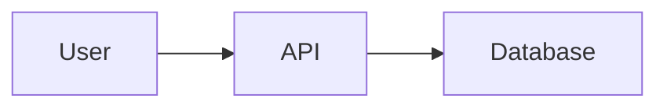

# Render Mermaid

Create Mermaid source, render it through the locally installed `mmdr` executable, and show the generated PNG to the user.

## Workflow

1. Use a unique temporary directory for the `.mmd` source and rendered output. Only save either file in the project when the user asks to keep it.
2. Run `scripts/render-mermaid.sh INPUT.mmd OUTPUT.png`.
3. Inspect `OUTPUT.png` with the local image viewer.
4. Display the inspected image directly in the answer. Always also provide a clickable link to the output image file, so the user can open it if inline rendering does not work.

For example:



## CLI requirement

The helper requires `mmdr` on `PATH`. If it is unavailable, explain the prerequisite and offer this installation command instead of rendering:

```sh
cargo install mermaid-rs-renderer
```

## Output guidance

- Prefer PNG because it can be displayed inline reliably.
- Use SVG only when the user explicitly needs a scalable asset; still produce a PNG preview if visual inspection is needed.
- Keep labels concise and use quoted labels when they contain punctuation that Mermaid may parse specially.
- Report Mermaid syntax or rendering failures plainly, including the CLI output, and do not fabricate an image.
